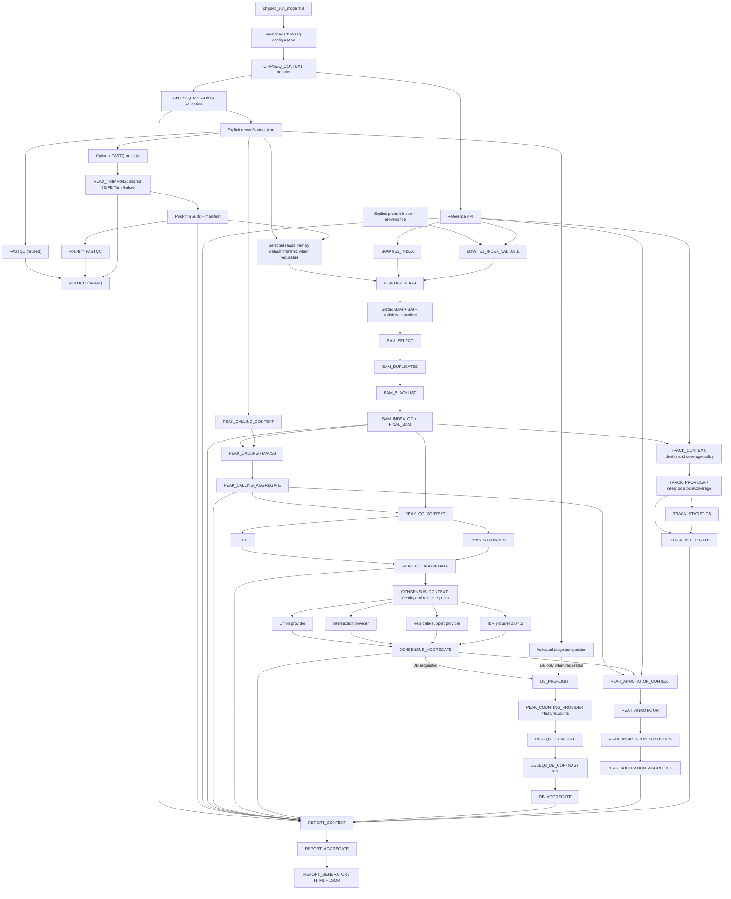

# Native ChIP-seq architecture

The native ChIP-seq workflow composes explicit read-processing, alignment,
filtering, peak, inference and reporting contracts. Differential Binding and
trimming are optional; accepted artifacts can enter postprocessing directly.
For the end-to-end contract map, see [ChIP-seq APIs](../api/chipseq-api.md).

## Boundaries

- `CHIPSEQ_CONTEXT` is a compatibility adapter: it sources the existing project
  config and writes a content-tracked settings snapshot.
- `CHIPSEQ_METADATA` is provider-neutral validation and planning. It resolves
  FASTQs, models controls and distinguishes biological from technical identity.
- Existing `FASTQC` and `MULTIQC` modules are reused unchanged.
- Optional `READ_TRIMMING` reuses the RNA-seq SE/PE tool modules, but receives
  an explicit ChIP-seq policy. Pre/post audits validate complete read streams
  and preserve control, biological and technical identities. Only selected
  reads reach alignment. Trimming is disabled by default and never introduced
  retrospectively into frozen benchmark claims.
- Generic `REFERENCE_INDEX` and `ALIGNMENT` dispatch by `meta.aligner`; Bowtie2
  joins STAR as a provider without creating a ChIP-specific alignment API.
- Bowtie2 reference dispatch selects construction or explicit prebuilt-index
  validation, never both for the same request. Validation checks reference,
  parameters, exact runtime version and all six shards before alignment. It
  does not reconstruct an index, including in independent runs without cache.
- `CHIPSEQ_BAM_PROCESSING` owns independent selection, duplicate, blacklist and
  final integrity/index boundaries. Policies are values/files, never aligner
  side effects.
- `PEAK_CALLING_CONTEXT` resolves one treatment/control request per replicate;
  `PEAK_CALLING` dispatches MACS3 and aggregation publishes caller-neutral roles.
- `PEAK_QC_CONTEXT` safely joins final BAM and peaks by stable identity. `FRIP`
  and `PEAK_STATISTICS` remain independent cache boundaries and the final
  aggregator preserves one row per replicate.
- `CONSENSUS_CONTEXT` joins peak and Peak QC manifests by stable IDs, validates
  complete grouping identity and makes biological/technical replicate policy
  explicit. Consensus providers operate on atomic segments; IDR remains a
  separate statistical provider with its own threshold, rank and provenance.
- `DB_PREFLIGHT` creates a recorded cross-condition peak universe and validates
  statistical units, design, covariates, filters and contrasts. featureCounts,
  model fitting, each contrast and aggregation are independent cache boundaries.
- `PEAK_ANNOTATION_CONTEXT` consumes an existing Peak Calling, Consensus or IDR
  manifest plus reference/annotation identity. Provider execution, annotation
  statistics, and provider-neutral aggregation are separate boundaries and
  never trigger peak calling or differential binding.
- In standalone `tracks` mode, `TRACK_CONTEXT` consumes an external final-BAM
  inventory and reference manifest. In `full`, the same contract receives the
  live final-BAM and reference channels. It validates identity and explicit coverage semantics before a
  provider creates individual and optional non-control aggregate BigWigs.
  Statistics and aggregation are independent cache boundaries; tracks mode
  never triggers alignment or BAM processing.
- `REPORT_CONTEXT` is a terminal manifest-only integration boundary. It accepts
  optional components, preserves explicit status, and validates project,
  dataset, build, record/sample identity, and version compatibility.
  `REPORT_AGGREGATE` owns scientific structure; `REPORT_GENERATOR` owns only
  presentation and cannot schedule an upstream producer.
- `CHIPSEQ_FULL_REPORT_INPUT` constructs the report inventory only from native
  manifests and checksum-declared semantic artifacts in the current execution.
- Large data remain Nextflow outputs. Lightweight reports and provenance are
  published under `pipeline_info` and configured target paths.
- `annotation`, `tracks`, and `report` remain standalone manifest-inventory
  re-entry modes. Under `full`, they are composed directly by channels and do
  not discover published result directories.
- DB is independent from postprocessing. A validated plan gates scientific
  inputs; full without DB and consensus/IDR with postprocessing still reach
  annotation, tracks and reporting without a fabricated contrast.
- `post_consensus` validates an explicit accepted-artifact inventory before
  calling the existing annotation/track/report APIs. It contains no upstream
  producer and preserves source IDs and not-requested component status.
- The `full` coordinator completed a reduced end-to-end Slurm run. Separately,
  the frozen ChIP-seq benchmark includes synthetic and reviewed biological
  narrow/broad evaluations and is classified `PASS_WITH_LIMITATIONS`; these
  results validate the tested scenarios, not every possible dataset.

The Nextflow executor owns all scheduling. Modules contain no Slurm submission,
partition, account or host-specific path logic. Profiles select local, Slurm,
Docker, Conda, Singularity or Apptainer execution.

Top-level validation evidence is recorded in
[chipseq-full-native-validation.md](../validation/chipseq-full-native-validation.md).
The broader scientific baseline is documented in the
[ChIP-seq benchmark report](../../benchmark/chipseq/reports/chipseq_benchmark_final_report.md).

## Component composition

The workflow composes metadata and QC, Bowtie2 alignment, BAM processing,
MACS3 peak calling, FRiP/Peak QC, Consensus or optional IDR, optional Differential
Binding, Peak Annotation, Track Generation and Report APIs. Each boundary is
manifest-driven and independently cacheable.
