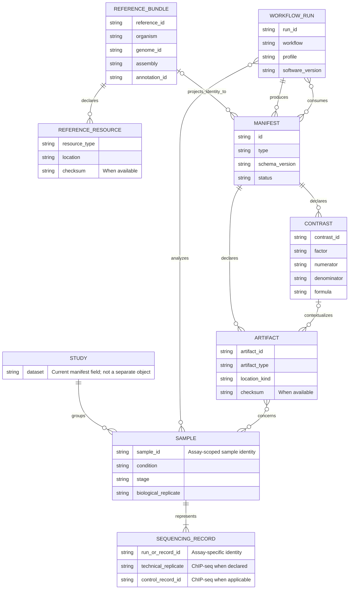

# HelixForge conceptual data model

This diagram describes the identities and relationships used by HelixForge's
RNA-seq, ChIP-seq and Integrative contracts. It is a **conceptual view**, not a
database schema, a new public API or a request to normalize the current JSON
manifests. The versioned schemas remain authoritative.

The cardinalities express scientific relationships, **not** storage constraints
or foreign keys. A run may be incomplete and produce no terminal manifest; a
stage-specific run may produce only a domain manifest. Integrative runs consume
the RNA-seq and ChIP-seq terminal manifests rather than rediscovering files.
Reference identity is required in terminal manifests, but not necessarily in
every stage manifest; the integrative run checks the two assay references for
compatibility. Contrasts belong to assay
manifests and are optional; each assay artifact names at most one contrast,
while a contrast may have several artifacts.

## Entity dictionary

| Entity | Current representation and identity | Important distinction |
|---|---|---|
| Study | `dataset` on assay samples/records. There is no separate Study JSON object in the v1 terminal contracts. | A dataset label groups observations; it does not make technical libraries independent biological replicates. |
| Sample | RNA-seq `samples[].sample_id`; ChIP-seq `samples[].sample_id` alongside `record_id`. | RNA samples are the biological analysis units. In ChIP-seq, `sample_id` identifies a sample within each declared sequencing record; do not infer biological independence or global uniqueness from the ID alone. |
| Sequencing record | RNA-seq `samples[].technical_runs[]` (IDs, not full objects); ChIP-seq `samples[].record_id`, `technical_replicate`, `is_control` and `control_record_id`. | Several RNA technical runs can belong to one biological sample. ChIP control association refers to a declared record, not an inferred filename. |
| Reference Bundle | Reference Bundle manifest, projected into terminal `reference`; identity includes `reference_id`, organism, genome and assembly. | Organism and assembly are different fields. Cross-assay compatibility is validated from declared identity. |
| Reference resource | Typed resource in `reference.resources`, with location and optional SHA-256. | A FASTA, annotation or transcriptome is part of the declared reference, not a sample artifact. |
| Workflow run | Terminal `run` envelope (`run_id`, workflow, versions, commit and profile). | One execution may produce multiple stage/component manifests; its work directory and cache are operational state, not scientific identity. |
| Manifest | Versioned stage, evidence or terminal document identified by `id` and `type`. | A terminal manifest is the stable machine-readable boundary. An integrative terminal manifest explicitly names its two input manifests. |
| Artifact | Assay terminal `artifacts[]` use the shared artifact schema: `artifact_id`, semantic type, assay, location, context and optional checksum. Integrative terminal artifacts use a smaller, separately defined projection with `source_manifest_id` and required SHA-256. | Resolve by semantic role and declared location kind; do not infer meaning from result paths or filenames. |
| Contrast | `contrasts[]`, identified by `contrast_id`, with factor, numerator, denominator, formula and covariates. | A contrast is a declared comparison, not an extra sample or a value reconstructed from a filename. |

Provenance (producer, software, parameters and upstream IDs) is embedded in
manifests and artifacts. Checksums and locations are attributes, not proposed
standalone entities. This view does not introduce a database, global ID
registry, new validation rule or changes to scientific analysis.

## Contract anchors

- [Integration API](../api/integration_api.md): reference, run, artifact,
  contrast and path semantics.
- [Terminal manifests](../api/terminal_manifests.md): assay-specific sample
  and technical-record representation.
- [Evidence model](../api/evidence_model.md): downstream evidence identities
  and source-artifact lineage.
- [Output guide](../guides/outputs.md): stable manifest boundary versus
  operational files.
- Authoritative schemas:
  [`rnaseq-run-manifest.schema.json`](../../schemas/integration/rnaseq-run-manifest.schema.json),
  [`chipseq-run-manifest.schema.json`](../../schemas/integration/chipseq-run-manifest.schema.json)
  and
  [`integrative-run-manifest.schema.json`](../../schemas/integration/integrative-run-manifest.schema.json).
