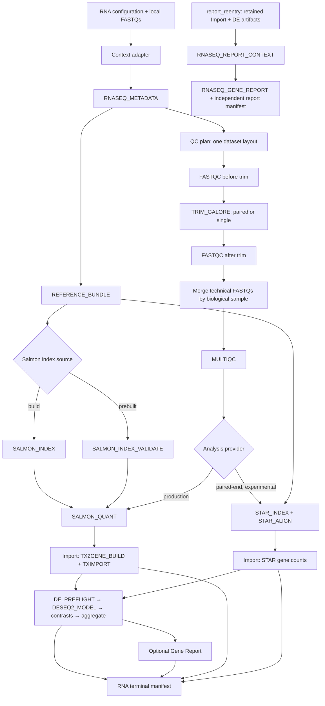

# Native RNA-seq architecture

This page is the RNA-seq counterpart to the [ChIP-seq architecture](chipseq-architecture.md).
It describes composition and scientific boundaries, not module arguments or a
second version of the API contracts. The [platform architecture](architecture.md)
shows how RNA-seq connects to the other workflows.
For the end-to-end contract map, see [RNA-seq APIs](../api/rnaseq-api.md).

The diagram shows the complete composition, not an instruction to run every
branch. Alignment and quantification can be selected independently; `both`
fans out the same merged reads without making STAR a prerequisite for Salmon.
The `report_reentry` branch is separate from QC, quantification, Import and DE.

## Input and sample boundaries

- Acquisition is outside the scientific DAG. The context adapter consumes the
  existing `pipeline_config.sh`; native metadata validation and Reference
  Bundle construction start the tracked workflow.
- The normalized metadata distinguish technical sequencing runs from biological
  samples. FASTQ merge preserves that grouping before quantification. Runs are
  not treated as independent biological replicates merely because they have
  distinct accessions.
- A dataset uses either paired-end or single-end libraries, not a mixture.
  Single-end needs R1 plus explicit fragment-length mean and SD; it has no R2.
  STAR single-end is rejected. See the [single-end contract](../guides/rnaseq-single-end.md).
- A prebuilt Salmon index is validated as a declared input; the build and
  validation paths are separate. An unchanged index need not be rebuilt on
  every execution. See the [Quantification API](../api/quantification_api.md).

## Analysis boundaries

| Boundary | Responsibility |
|---|---|
| QC | Per-FASTQ FastQC, layout-aware trimming, post-trim QC, biological-sample merge and reusable MultiQC. |
| Alignment | Optional STAR provider, currently experimental; it does not feed Salmon quantification. |
| Quantification | Production Salmon provider, using an existing validated index or a separately built index. |
| Import | Provider-specific Salmon/tximport or STAR gene-count ingestion into provider-neutral matrices and metadata. Downstream DE does not inspect Salmon or STAR filenames. |
| Differential Expression | Validate sample identities, design and contrasts; fit DESeq2 once per design, then evaluate contrasts independently. Batch, when estimable, belongs in the formula rather than in an automatically corrected count matrix. |
| Report | Optional exploratory Gene Report, downstream of Import and DE; it cannot alter DE inference. |
| Terminal manifest | Projects declared samples, reference, contrasts, artifacts and provenance into `rnaseq_run_manifest.json`; it does not scan the published result tree. |

The public stop points are `qc`, `alignment`, `quantification` (`quant`),
`import`, `de` (`differential_expression`), `report` and `full`.
`report_reentry` is a separate terminal-only mode. `de` stops at DE
aggregation; `report` requires Import and DE; `full` can include the optional
Gene Report. Exact user inputs and mode behavior are in the
[workflow guide](../guides/workflows.md).

## Re-entry and provenance

`report_reentry` consumes retained Import/DE manifests and declared abundance,
sample-table, annotation, DE and candidate-gene inputs. It checks their
identities and checksums, then produces a **new report manifest** without
rewriting the accepted RNA terminal manifest. It does not need original FASTQs,
Salmon outputs, the originating `work/` directory or Nextflow cache. See the
[Report API](../api/rnaseq_report_api.md#terminal-only-re-entry).

Normal execution uses Nextflow channels and tracked inputs between boundaries.
The executor owns Slurm scheduling; modules do not submit nested jobs. Cache
reuse requires the task database and work outputs to remain available; it is
an operational mechanism, not part of the scientific output contract.

Current detailed contracts: [Alignment](../api/alignment_api.md),
[Quantification](../api/quantification_api.md), [Import](../api/import_api.md),
[Differential Expression](../api/differential_expression_api.md),
[Report](../api/rnaseq_report_api.md), and
[terminal manifests](../api/terminal_manifests.md). The paired-end biological
baseline and reduced single-end Slurm validation are scoped separately in the
[limitations](../guides/limitations.md) and
[single-end validation record](../validation/rnaseq-single-end-slurm-validation.md).
