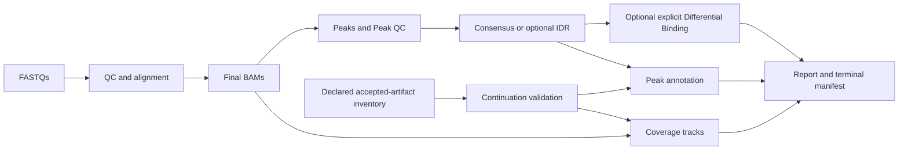

# ChIP-seq stage composition and continuation

Use the native ChIP-seq stages without inventing a differential-binding
contrast. Annotation consumes selected peaks; coverage tracks consume final
BAMs, not peaks. The existing standalone `annotation`, `tracks` and `report`
modes remain available.

## Choose an execution path

| Entry point | Inputs | Differential Binding | Final outputs |
|---|---|---|---|
| `full --chipseq_db_enabled false` | Configured FASTQs/reference | Not requested | Consensus/IDR, annotation, tracks, report, terminal manifest |
| `full` with `chipseq_db_spec` | Configured FASTQs/reference and explicit DB specification | Requested | Existing complete DB-enabled path |
| `consensus` or `idr`, with `chipseq_postprocess true` | Configured FASTQs/reference | Not requested | Consolidation followed by annotation, tracks, report, terminal manifest |
| `post_consensus` | Accepted artifacts declared in an inventory | Not requested | Annotation, tracks, report, terminal manifest |
| `report` | Existing report input inventory | No scientific producer | Updated presentation of declared results |

`chipseq_db_enabled` accepts `true` or `false`. When omitted, DB is selected in
`full` only if `chipseq_db_spec` is supplied; `differential_binding` mode always
requires it. Explicit `false` disables DB even when a parameter file supplies
a specification. `true` requires `full` or `differential_binding` mode and an
existing specification. Missing/invalid contrasts, inadequate biological
replication, incompatible counting units and non-estimable designs fail during
planning, before scientific producers receive their inputs. The original
artifact-aware DB preflight remains in place as an additional validation.

```bash
# Complete analysis without Differential Binding
nextflow run . -profile slurm --workflow chipseq \
  --chipseq_run_mode full --chipseq_db_enabled false \
  --chipseq_config /path/to/pipeline_config.sh --outdir /path/to/results

# Complete an IDR path without adding a DB contrast
nextflow run . -profile slurm --workflow chipseq \
  --chipseq_run_mode idr --chipseq_postprocess true \
  --chipseq_config /path/to/pipeline_config.sh --outdir /path/to/results
```

Full/postprocessing requires one dataset/reference and an annotation. IDR
retains the replicate and peak-type requirements in the
[Consensus/IDR API](../api/consensus_idr_api.md). The requested stages are recorded
in `pipeline_info/native_chipseq/plan/chipseq.execution_plan.json`.

## Continue from accepted consensus or IDR

Create a `chipseq_continuation_input` JSON inventory using the
[template](../../assets/chipseq_continuation.example.json). It must declare:

- `project`: project ID, dataset, genome ID and build;
- `metadata`: normalized metadata table and its producer manifest;
- `reference`: FASTA, annotation and Reference Bundle manifest;
- `peaks`: each consolidated BED and its `consensus` or `idr` **provider**
  manifest, not only the cross-group aggregate summary;
- `records`: each record ID, final BAM, BAI and `bam_final` manifest;
- optional `source_manifests`: compatible QC/alignment/peak component manifests
  to retain in the report.

Paths may be absolute or relative to the inventory file. Records must match the
normalized metadata exactly. Replicate sample IDs, biological/technical IDs,
condition, mark/factor, controls and reference identity must agree. Checksums
are mandatory for the metadata table, FASTA, annotation, consolidated BED, BAM
and BAI. Failed/incomplete producers are rejected. Missing inputs are errors;
the continuation never searches result directories or rebuilds upstream data.

```bash
nextflow run . -profile slurm --workflow chipseq \
  --chipseq_run_mode post_consensus \
  --chipseq_continuation_manifest /path/to/continuation.json \
  --outdir /path/to/continued-results
```

No FASTQ configuration or DB design is required. Existing annotation and track
parameters apply. Optional track aggregation preserves the configured
condition/target grouping and does not convert technical records into
biological replicates. Selecting tracks does not schedule peak calling, and
selecting annotation does not schedule alignment.



## Results and report-only re-entry

The continuation publishes component manifests, annotation/track products,
`chipseq/report/report_result/`, and the terminal
`chipseq/chipseq_run_manifest.json`. The terminal contract retains original
producer IDs and explicitly records DB as `not_requested` in provenance;
it has no fabricated DB contrasts or DB artifacts. The report likewise shows
DB as not requested. Unprovided historical QC/alignment components are not part
of this report inventory; their absence does not establish that they were never
performed in the original analysis.

The generated report inventory and its staged small inputs are published under
`pipeline_info/native_chipseq/full/`. To render the report again without
annotation, track generation or any upstream producer:

```bash
nextflow run . -profile slurm --workflow chipseq \
  --chipseq_run_mode report \
  --chipseq_report_input_manifest /path/to/continued-results/pipeline_info/native_chipseq/full/chipseq_full_report_input.json \
  --outdir /path/to/report-results
```

Report-only mode produces a report, not a new assay analysis. It does not
relabel omitted components as successful or create a new terminal assay bundle.
Keep original producer artifacts available for continuation. The terminal
bundle copies integration-relevant tables/peaks, not all large BAMs or coverage
tracks. Relocating those large files requires updating their declared locations
while retaining source identities and checksums.

## Functional tests

`tests/native_chipseq_composition/run_functional.py --output /path/to/new-case`
creates small synthetic fixtures and checks DB-disabled/enabled composition,
accepted consensus/IDR continuation, incompatible-input rejection, terminal
contracts, report-only isolation and reuse of compatible producers. Add
`--stub` for orchestration checks without scientific tool execution. The real
fixture requires the existing ChIP-seq, DESeq2 and report toolchains and the
certified Nextflow launcher. It installs nothing and does not submit jobs;
on HPC, run it inside a compute allocation. These are functionality checks,
not biological or performance benchmarks.
