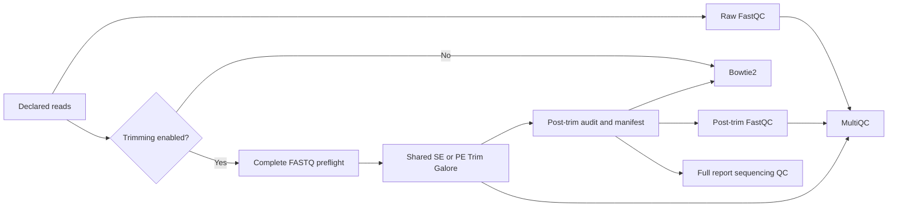

# Optional native ChIP-seq trimming

## Scope and policy

The native ChIP-seq foundation provides an optional, assay-neutral read-trimming
adapter. It reuses the shared `TRIM_GALORE` and
`TRIM_GALORE_SINGLE` modules rather than introducing another trimming tool.
Raw reads remain the default. No frozen benchmark or historical dataset is
reprocessed or described as trimmed by this change.

Enable trimming explicitly alongside the existing ChIP configuration:

```bash
nextflow run . -profile slurm \
  --workflow chipseq --chipseq_run_mode alignment \
  --chipseq_config /path/to/pipeline_config.sh \
  --chipseq_trim true --chipseq_trim_quality 20 --chipseq_trim_length 20 \
  --outdir /path/to/results
```

The values above illustrate syntax, not a recommended universal scientific
policy. Quality (integer 0–40) and minimum length (positive integer) are required
when enabled. `chipseq_trim_adapter` optionally supplies an IUPAC adapter;
`chipseq_trim_adapter2` requires adapter 1 and is PE-only. With no explicit
adapter the manifest records Trim Galore auto-detection. RNA parameters are
never implicitly borrowed. The same option applies to all foundation-consuming
modes, including `full`; standalone downstream re-entry does not trim reads.

## Data flow



There is no automatic fallback after a trimming/audit failure. The adapter
validates gzip/plain FASTQ content, record structure, nonempty libraries,
mate count, read IDs and mate orientation. It keeps biological/technical IDs
and IP/control links; it neither pools runs nor creates biological replicates.

Outputs are gzip FASTQs under `trimmed_reads/<record_id>/`, original trimming
reports under `pipeline_info/native_qc/trim_galore/`, and raw/post validation
manifests plus execution records under `pipeline_info/native_qc/read_trimming/`.
Manifests record raw/selected SHA-256, read/base counts, retention, parameters,
identity and tool versions. Nextflow owns scheduling and publication. Full
reports include trimming provenance; MultiQC receives raw/post FastQC ZIPs and
Trim Galore reports. Raw mode retains `raw_fastq_multiqc.html`; enabled mode
uses `trimmed_fastq_multiqc.html`.

## Tests and support boundaries

- Twelve unit tests reject malformed, truncated, empty, unsynchronized and
  incorrectly oriented reads, invalid policies and changed identities.
- Report tests verify that trimming manifests reach sequencing QC.
- SE/PE stubs check orchestration with trimming off/on and require published
  FASTQs and trimming reports, not just successful task exits.
- The RNA QC mock regression checks shared-module compatibility.

The reproducible fixture driver is
`tests/native_chipseq_trimming/run_functional.py --output /path/to/new-case`.
Add `--stub` for orchestration only. It creates four libraries (SE/PE IP/control),
three fragments per library and a 4 kb artificial reference. Real execution
checks adapter removal, direct-tool equivalence, FASTQ checksums, mapped BAM
records, MultiQC, unchanged raw inputs, identical resume and selective quality
parameter invalidation. Tool dependencies must already be available; this
driver does not install environments or submit jobs.

This is a small functionality check, not a biological benchmark, performance
comparison, new peak-calling certification or OCI/Apptainer certification.
When running the fixture on a cluster, use a compute allocation rather than a
login node. Full-stream validation adds I/O when trimming is enabled; it fails
on an all-filtered library instead of silently changing the experimental design.
