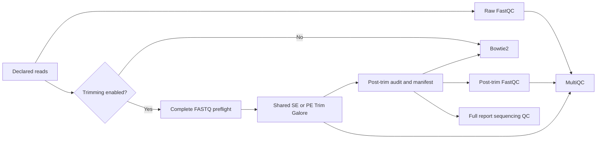

# Optional native ChIP-seq trimming

## Scope and policy

Issue #102 adds an optional, assay-neutral read-trimming adapter to the native
ChIP-seq foundation. It reuses the existing RNA-seq `TRIM_GALORE` and
`TRIM_GALORE_SINGLE` modules rather than introducing another trimming tool.
Raw reads remain the default. No frozen benchmark or historical dataset is
reprocessed or described as trimmed by this change.

Enable trimming explicitly alongside the existing ChIP configuration:

```bash
nextflow run . -profile slurm \
  --workflow chipseq --chipseq_run_mode alignment \
  --chipseq_config /path/to/pipeline_config.sh \
  --chipseq_trim true --chipseq_trim_quality 20 --chipseq_trim_length 20 \
  --outdir /path/to/results
```

The values above illustrate syntax, not a recommended universal scientific
policy. Quality (integer 0–40) and minimum length (positive integer) are required
when enabled. `chipseq_trim_adapter` optionally supplies an IUPAC adapter;
`chipseq_trim_adapter2` requires adapter 1 and is PE-only. With no explicit
adapter the manifest records Trim Galore auto-detection. RNA parameters are
never implicitly borrowed. The same option applies to all foundation-consuming
modes, including `full`; standalone downstream re-entry does not trim reads.

## Data flow



There is no automatic fallback after a trimming/audit failure. The adapter
validates gzip/plain FASTQ content, record structure, nonempty libraries,
mate count, read IDs and mate orientation. It keeps biological/technical IDs
and IP/control links; it neither pools runs nor creates biological replicates.

Outputs are gzip FASTQs under `trimmed_reads/<record_id>/`, original trimming
reports under `pipeline_info/native_qc/trim_galore/`, and raw/post validation
manifests plus execution records under `pipeline_info/native_qc/read_trimming/`.
Manifests record raw/selected SHA-256, read/base counts, retention, parameters,
identity and tool versions. Nextflow owns scheduling and publication. Full
reports include trimming provenance; MultiQC receives raw/post FastQC ZIPs and
Trim Galore reports. Raw mode retains `raw_fastq_multiqc.html`; enabled mode
uses `trimmed_fastq_multiqc.html`.

## Focused validation, not benchmarking

- Twelve unit tests reject malformed, truncated, empty, unsynchronized and
  incorrectly oriented reads, invalid policies and changed identities.
- Report tests verify that trimming manifests reach sequencing QC.
- Nextflow 25.10.7 SE/PE stub fixture passes with trimming both off and on.
- Existing RNA QC mock regression passes after shared-module integration.
- Real-tool Slurm fixture: **PASS**, job `28937`, completed with exit `0:0`
  on 2026-10-17. One compute allocation (2 CPUs, 6 GB) ran the tiny local
  task executor; no scientific processing occurred on the head node.

| Functional case | Tasks | Completed | Cached |
|---|---:|---:|---:|
| Trimming off | 12 | 12 | 0 |
| Trimming on, quality 20 | 30 | 30 | 0 |
| Identical resume | 30 | 0 | 30 |
| Quality changed to 25 | 30 | 13 | 17 |

Both SE and PE outputs removed the known adapter and matched decompressed
direct-tool FASTQ records exactly. Published FASTQ SHA-256 matched the audit;
all four trimmed BAMs passed integrity checks and contained the expected
mapped records (3 SE reads or 6 PE alignments per library). MultiQC was present,
all identity/control fields were retained and raw input checksums were unchanged.
Changing quality reran trimming while preserving raw FastQC and the Bowtie2
index. Descendants whose tracked content remained identical could remain cached.

The recorded Conda tools were Trim Galore 0.6.10, Cutadapt 5.1, FastQC 0.12.1,
MultiQC 1.35, Bowtie2 2.5.5, samtools 1.23.1 and Python 3.13.14; Nextflow
25.10.7 used Java 21. This is evidence for that existing Slurm/Conda runtime,
not certification of another OCI image. No environment was installed or modified.

Preparatory attempts identified an unintended newer Trim Galore on `PATH`,
an incorrect fixture ID comparison and a genuine conditional-publication bug.
The final run used the intended version and corrected publication; the CI stub
now requires the published SE/PE FASTQs and trimming report directories, not
just successful task exits. Earlier diagnostics and final evidence were
preserved together in a verified private ZIP with a Portuguese README.

GitHub Actions discovered and ran the 349-test repository suite successfully.
The local WSL broad-suite attempt retained an environment failure because its
older JSON Schema installation lacked `referencing`; it is not reported as a
successful local broad-suite run. Focused local tests and documentation links
passed, and final Nextflow lint reported no errors.

The reproducible fixture driver is
`tests/native_chipseq_trimming/run_functional.py --output /path/to/new-case`.
Add `--stub` for orchestration only. It creates four libraries (SE/PE IP/control),
three fragments per library and a 4 kb artificial reference. Real execution
checks adapter removal, direct-tool equivalence, FASTQ checksums, mapped BAM
records, MultiQC, unchanged raw inputs, identical resume and selective quality
parameter invalidation. Tool dependencies must already be available; this
driver does not install environments or submit jobs.

This is a small functionality check, not a biological benchmark, performance
comparison, new peak-calling certification or OCI/Apptainer certification.
Local tasks on the cluster run only inside a Slurm compute allocation. Private
raw logs and audit archives are not committed. Full-stream validation adds I/O
when trimming is enabled; it deliberately fails on an all-filtered library
instead of silently changing the experimental design.
