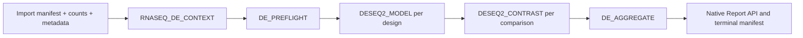

# Native RNA-seq differential expression

The [Differential Expression API](../api/differential_expression_api.md)
consumes provider-neutral Import outputs, not Salmon/STAR directories.



`DE_PREFLIGHT` validates checksums, sample identity, biological replication,
contrast levels, count/filter policies and model rank. Only the supported Wald
test is accepted. Batch belongs in an estimable design, such as
`~ batch + condition`; corrected visualization matrices never replace the
inferential Import counts.

Model fitting, contrasts and aggregation are separate deep-cache boundaries.
A contrast-only change preserves a compatible fitted model. The aggregate
retains the documented count/DE tables, DDS objects and scientific figures.
Provider-neutral results expose `statistic`; compatibility tables retain
DESeq2's `stat`. Historical scripts remain only in `rnaseq-legacy-v1.0.0`;
`--rnaseq_native_de false` cannot select a fallback.

## Validation

The repository checks invalid designs/counts/contrasts, provider stubs,
legacy-versus-native semantic regression, container execution and contrast-only
cache behavior. Run the corresponding fixtures with the certified runtime:

```bash
NEXTFLOW=/path/to/official/nextflow tests/native_de/run_stub.sh
NEXTFLOW=/path/to/official/nextflow tests/native_de/run_regression.sh
```

The regression uses the pinned DESeq2 image and requires its container runtime.
It is separate from biological interpretation and from the frozen
[RNA-seq benchmark](../../benchmark/rnaseq/README.md). Runtime versions and
support boundaries are in the [inventory](../guides/runtime-inventory.md) and
[limitations](../guides/limitations.md).
